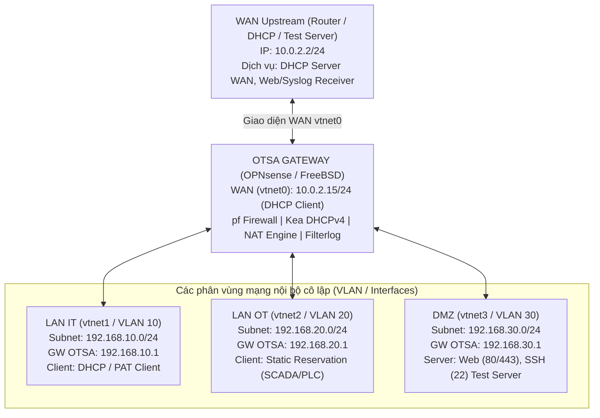

# TÀI LIỆU KỊCH BẢN KIỂM THỬ TỔNG HỢP OTSA GATEWAY (NAT - DHCP - LOGGING - HỆ THỐNG)

---

## 1. MÔ HÌNH KIỂM THỬ CHUNG (TEST TOPOLOGY)

### Bảng thông số cấu hình mạng minh họa

| Thành phần | Giao diện mạng | Địa chỉ IP / Subnet | Gateway trỏ về | Vai trò & Dịch vụ kiểm thử |
| :--- | :--- | :--- | :--- | :--- |
| **OTSA WAN** | `vtnet0` | `10.0.2.15/24` (Động) | `10.0.2.2` | Nhận IP qua DHCP từ Upstream; thực hiện NAT Outbound/Inbound |
| **Upstream Router** | Card WAN Lab | `10.0.2.2/24` (Tĩnh) | Trực tiếp | Cấp DHCP WAN; giả lập Internet/External Client & SIEM Collector |
| **LAN IT** | `vtnet1` / VLAN 10 | `192.168.10.0/24` (GW: `.1`) | `192.168.10.1` | Client nhận IP động qua Kea DHCP, gửi traffic PAT/Outbound |
| **LAN OT** | `vtnet2` / VLAN 20 | `192.168.20.0/24` (GW: `.1`) | `192.168.20.1` | Thiết bị công nghiệp nhận IP cố định (Reservation `192.168.20.10`) |
| **DMZ Server** | `vtnet3` / VLAN 30 | `192.168.30.0/24` (GW: `.1`) | `192.168.30.1` | Web Server (`192.168.30.10:80/443`), SSH Server (`:22`) nhận DNAT |
| **Virtual IP (Alias)** | `vtnet0` (WAN Alias) | `10.0.2.50/24` | N/A | Dùng cho 1-to-1 NAT, Port Forward VIP, Hybrid SNAT VIP |

---

## 2. NGUYÊN TẮC PHÂN TÁCH TRẠNG THÁI KIỂM THỬ (TEST CONSTRAINTS)

Để kết quả kiểm thử chính xác và khách quan, các kịch bản sau **bắt buộc chạy ở các điều kiện/trạng thái cấu hình độc lập**:
- **NAT Outbound**: Tách riêng 4 chế độ loại trừ nhau: *Automatic*, *Hybrid*, *Manual*, *Disabled*.
- **Truy cập dịch vụ nội bộ**: Tách riêng đường đi chuyển dịch *NAT Reflection* và phân giải trực tiếp *Split-DNS*.
- **Inbound NAT**: Tách riêng cơ chế *Port Forward (N-to-1 D-NAT)* và *1-to-1 NAT*.
- **DHCP Pool**: Đo cấp phát dải *Bình thường* trước, sau đó mới kích hoạt kịch bản *Pool Exhaustion (Cạn kiệt)*.
- **Dịch vụ Kea DHCP**: Trạng thái chạy *Bình thường* tách riêng với trạng thái *Cố tình Crash/Kill daemon*.
- **Logging**: Trạng thái *Log Tắt* tách riêng với *Log Bật* để đối chứng luồng dữ liệu.
- **Log Storage**: Vận hành *Bình thường* tách riêng với môi trường *Disk Full / Flooding*.
- **Hiệu năng**: Đo đạc *Baseline khi chưa tải/chưa log* trước khi kích hoạt *Stress Test*.
- **Giao thức**: Tách biệt kiểm thử *NAT IPv4* và *NPTv6 (Stateless Prefix Translation)*.

---

## 3. NỘI DUNG 5 ĐỢT CHẠY KIỂM THỬ TẬP TRUNG (5 TEST CAMPAIGNS)

---

### ĐỢT 1: DHCP + OUTBOUND NAT + WAN DHCP CLIENT

> **Mục tiêu đợt 1:** Thiết lập toàn bộ hạ tầng cấp phát IP nội bộ (LAN IT, LAN OT, Multi-VLAN, Options, Lease Lifecycle, Trùng IP/Cạn Pool) và xác thực 4 chế độ Outbound NAT khi kết nối ra mạng ngoài.

#### Bảng 1.1: Khởi tạo DHCP Client trên WAN và Cấp phát DHCP LAN cơ bản (Normal State)
| Nội dung | Cách thức thực hiện (Thao tác Web UI / Lệnh Console) | Tiêu chí nghiệm thu (Output / Expected Result) | Ý nghĩa xác minh |
| :--- | :--- | :--- | :--- |
| **WAN DHCP Client khởi tạo** | 1. Web UI: Vào *Interfaces > [WAN]*, mục *IPv4 Configuration Type* chọn **DHCP**. 2. Bấm **Save** -> **Apply changes**. 3. Console OTSA: `sh -c "netstat -rn; ifconfig vtnet0"` | - Card `vtnet0` nhận đúng IP `10.0.2.15/24`. - Bảng định tuyến xuất hiện: `default via 10.0.2.2`. - Tiến trình `dhclient` chạy nền trên interface `vtnet0`. | Xác nhận card WAN hoạt động như DHCP client chuẩn, tự nhận IP, default gateway và DNS từ upstream router. |
| **Cấp phát Kea DHCPv4 cơ bản trên LAN IT** | 1. Web UI: Vào *Services > Kea DHCPv4 > Subnets*, bấm **+** (Thêm): - *Subnet*: `192.168.10.0/24` - *Pool*: `192.168.10.100 - 192.168.10.200` - *Interface*: LAN IT (`vtnet1`) 2. Bấm **Save** -> **Apply changes**. 3. Tại Client LAN IT: `ipconfig /renew` (Windows) hoặc `dhclient -v eth0` (Linux). | - Quá trình 4 bước `Discover -> Offer -> Request -> ACK` hoàn tất trong tcpdump. - Client nhận IP nằm trong dải `192.168.10.100 - .200`, Gateway: `192.168.10.1`. - Trang *Services > Kea DHCPv4 > Leases* hiển thị đúng IP, MAC, Hostname. | Đảm bảo Kea DHCPv4 cấp phát địa chỉ IP và thông số mạng cơ bản chính xác cho thiết bị kết nối mới. |
| **Cấp phát đa phân đoạn Multi-VLAN độc lập** | 1. Web UI: Thêm tiếp Subnet thứ 2 trong Kea DHCPv4: - *Subnet*: `192.168.20.0/24`, *Pool*: `192.168.20.100 - .200`, *Interface*: LAN OT (`vtnet2`). 2. Gửi DHCP Request đồng thời từ Client vùng IT và Client vùng OT. | - Client IT chỉ nhận IP dải `192.168.10.x` với GW `192.168.10.1`. - Client OT chỉ nhận IP dải `192.168.20.x` với GW `192.168.20.1`. - Hoàn toàn không có hiện tượng broadcast rò rỉ hoặc cấp nhầm dải mạng chéo VLAN. | Kea DHCP server quản lý độc lập nhiều subnet trên các interface logic khác nhau mà không xung đột dải cấp phát. |
| **Gán IP cố định theo MAC (Static Reservation)** | 1. Web UI: Vào *Services > Kea DHCPv4 > Reservations*, bấm **+**: - *Subnet*: `192.168.20.0/24` - *MAC Address*: `00:50:56:a1:b2:c3` (MAC của máy trạm SCADA) - *IP Address*: `192.168.20.10` - *Hostname*: `scada-server` 2. Bấm **Save** -> **Apply changes**. 3. Khởi động xin IP từ máy trạm SCADA mang đúng MAC trên. | - Máy SCADA nhận chính xác địa chỉ cố định `192.168.20.10` dù dải pool động đang ở giá trị nào. - Màn hình Lease đánh dấu trạng thái bản ghi là *Reserved / Static*. | Đảm bảo các thiết bị công nghiệp trọng yếu luôn nhận đúng IP cố định theo định danh phần cứng. |
| **Phân phối DHCP Options toàn mạng & Riêng lẻ** | 1. Trong Kea Subnet `192.168.10.0/24`, cấu hình Options: - *Option 3* (Routers): `192.168.10.1` - *Option 6* (DNS): `192.168.10.1` - *Option 15* (Domain): `factory.otsa` - *Option 42* (NTP): `192.168.10.1` - *Option 121* (Classless Route): `10.50.0.0/16 via 192.168.10.254` 2. Client IT gõ: `ipconfig /all` và `route print` (hoặc `ip route`). | - Client nhận đủ Domain Suffix `factory.otsa`, DNS `192.168.10.1`. - Bảng định tuyến máy trạm tự động nạp tuyến đường tĩnh: `10.50.0.0/16` trỏ về `192.168.10.254`. | Xác thực Kea truyền tải chuẩn xác các tham số mạng mở rộng và tuyến tĩnh xuống client. |

#### Bảng 1.2: Vòng đời Lease, Xử lý Cạn kiệt Pool và Trùng lặp IP
| Nội dung | Cách thức thực hiện (Thao tác Web UI / Lệnh Console) | Tiêu chí nghiệm thu (Output / Expected Result) | Ý nghĩa xác minh |
| :--- | :--- | :--- | :--- |
| **Vòng đời Lease (Renew, Rebind, Release)** | 1. Web UI: Sửa Subnet IT đặt *Valid Lifetime* = `120`, *Renew Time (T1)* = `60`, *Rebind Time (T2)* = `105`. Bấm **Apply**. 2. Client xin IP, chờ 60 giây quan sát log gia hạn. 3. Client chủ động giải phóng: `ipconfig /release` (Windows) hoặc `dhclient -r` (Linux). | - Tại giây thứ 60, client gửi DHCP Request unicast và gia hạn thành công (không mất kết nối). - Sau khi gửi Release, file `kea-leases4.csv` và Web UI chuyển trạng thái IP sang giải phóng ngay lập tức. | Xác minh chu trình cấp - duy trì - thu hồi địa chỉ diễn ra chính xác theo thời gian cam kết. |
| **Chống cấp trùng IP (Conflict Detection)** | 1. Đặt tĩnh thủ công trên máy PC B: IP `192.168.10.150` (nằm trong pool nhưng chưa được cấp). 2. Cho PC A gửi DHCP Discover xin IP mới từ Kea. 3. Console OTSA kiểm tra log: `cat /var/log/kea/kea-dhcp4.log \| grep -i conflict` | - Kea thực hiện ICMP/ARP check phát hiện IP `192.168.10.150` đang có phản hồi. - Kea đánh dấu IP đó là `Declined/Conflict` và tự động cấp IP khác (`192.168.10.151`) cho PC A. | Tránh xung đột IP trên phân vùng mạng khi có thiết bị ngoài luồng tự ý đặt trùng địa chỉ. |
| **Xử lý Cạn kiệt Pool địa chỉ (Pool Exhaustion)** | 1. Web UI: Giới hạn Pool Subnet IT chỉ gồm 2 IP: `192.168.10.198 - 192.168.10.199`. Bấm **Apply**. 2. Kết nối 2 client A và B để chiếm hết 2 IP trên. 3. Kết nối client C thứ ba gửi DHCP Discover. 4. Console OTSA: `cat /var/log/kea/kea-dhcp4.log \| grep -i "no addresses available"` | - Client C không nhận được IP, hệ thống không cấp tràn ra ngoài subnet. - Log Kea xuất hiện cảnh báo rõ ràng: `DHCP4_NO_SOCKETS_OPEN` hoặc `no addresses available in pool`. - Không làm crash dịch vụ Kea. | Ngăn chặn cấp phát sai ngoài quy hoạch mạng và ghi nhận cảnh báo khi tài nguyên địa chỉ cạn kiệt. |
| **Chặn DHCP Request từ interface không cho phép** | 1. Gửi bản tin DHCP Discover từ phân vùng DMZ (`vtnet3` - chưa bật DHCP Subnet). 2. Bắt gói tin: `tcpdump -ni vtnet3 "port 67 or port 68"` | - Console hiển thị gói tin DHCP Discover đến nhưng hoàn toàn không có phản hồi DHCP Offer từ Kea. - Không rò rỉ thông tin hay cấp phát sai phân vùng. | Kiểm soát chặt chẽ phạm vi phục vụ, chỉ cấp phát IP trên các giao diện được chỉ định. |

#### Bảng 1.3: Kiểm thử 4 chế độ Outbound NAT (Chuyển đổi trạng thái tuần tự)
| Nội dung | Cách thức thực hiện (Thao tác Web UI / Lệnh Console) | Tiêu chí nghiệm thu (Output / Expected Result) | Ý nghĩa xác minh |
| :--- | :--- | :--- | :--- |
| **Chế độ 1: Automatic Outbound NAT** | 1. Web UI: Vào *Firewall > NAT > Outbound*, chọn **Automatic outbound NAT rule generation** -> Bấm **Save** -> **Apply changes**. 2. Client IT (`192.168.10.100`) ping & curl ra Upstream: `ping 10.0.2.2 -c 4` 3. Bắt gói tại WAN OTSA: `tcpdump -ni vtnet0 icmp` 4. Kiểm tra state: `pfctl -ss \| grep 10.0.2.2` | - Gói tin ICMP xuất hiện tại WAN có IP nguồn được dịch thành IP WAN `10.0.2.15`. - State table thể hiện: `192.168.10.100 -> 10.0.2.15 -> 10.0.2.2`. - Nhiều client truy cập cùng lúc đều được PAT ra các source port ngẫu nhiên. | Tự động dịch địa chỉ nguồn toàn bộ dải mạng nội bộ sang IP WAN chính xác khi đi ra ngoài Internet. |
| **Chế độ 2: Hybrid Outbound NAT (Ưu tiên Manual Rule)** | 1. Web UI: Tại *Firewall > NAT > Outbound*, chuyển sang **Hybrid outbound NAT rule generation** -> Bấm **Save**. 2. Bấm **+** tạo rule thủ công đầu tiên: - *Interface*: WAN - *Source*: Network `192.168.20.0/24` (Mạng OT) - *Translation / target*: Chọn Virtual IP `10.0.2.50` 3. Bấm **Save** -> **Apply changes**. 4. Client OT (`192.168.20.10`) gửi ping tới Upstream `10.0.2.2`. 5. Client IT (`192.168.10.100`) đồng thời ping tới Upstream `10.0.2.2`. | - Traffic từ Client OT khi ra card WAN mang source IP là Virtual IP `10.0.2.50`. - Traffic từ Client IT vẫn ra bằng IP chính của WAN `10.0.2.15` (theo luật Automatic). - Cả hai luồng kết nối đồng thời thông suốt. | Xác thực khả năng vừa giữ luật tự động cho đa số, vừa áp dụng luật thủ công ưu tiên cho dải OT đặc thù. |
| **Chế độ 3: Manual Outbound NAT (Loại bỏ luật ngầm)** | 1. Web UI: Chuyển sang **Manual outbound NAT rule generation** -> Bấm **Save**. 2. Chỉ giữ lại 1 rule duy nhất cho LAN IT (`192.168.10.0/24` SNAT sang WAN IP). Tuyệt đối **không** tạo rule cho LAN OT. 3. Bấm **Apply changes**. 4. Client IT gửi ping tới Upstream `10.0.2.2`. 5. Client OT gửi ping tới Upstream `10.0.2.2`. 6. Kiểm tra state: `pfctl -ss \| grep 192.168.20.` | - Client IT kết nối ra ngoài bình thường, có bản ghi translation trong `pfctl -ss`. - Client OT: gói tin đi ra WAN giữ nguyên IP gốc `192.168.20.10` (không có bản ghi translation trong state table). | Khẳng định khi sang chế độ Manual, hệ thống không tự sinh bất kỳ luật ngầm nào; chỉ subnet được định nghĩa mới được NAT. |
| **Chế độ 4: Disabled Outbound NAT (Pure Routing Mode)** | 1. Web UI: Chuyển Outbound NAT sang **Disabled outbound NAT rule generation** -> Bấm **Save** -> **Apply changes**. 2. Client IT ping Upstream: `ping 10.0.2.2` 3. Bắt gói trên WAN: `tcpdump -ni vtnet0 icmp` 4. Kiểm tra state: `pfctl -ss \| grep 10.0.2.2` | - Gói tin truyền qua OTSA ra interface WAN giữ nguyên 100% IP nguồn nội bộ `192.168.10.100`. - Không có bất kỳ bản ghi NAT translation nào trong pf state table. | Xác thực khả năng vận hành ở chế độ định tuyến thuần (Routed Mode) giữa các vùng mạng công nghiệp. |
| **Tự phục hồi NAT khi WAN DHCP đổi IP (Link Flap / Renew)** | 1. Khôi phục Outbound NAT về **Automatic**. 2. Trên Upstream Router, đổi cấu hình DHCP Server WAN sang dải mới `10.0.99.0/24`. 3. Console OTSA thực hiện làm mới IP WAN: `dhclient -r vtnet0 && dhclient vtnet0` 4. Client LAN gửi ping ra ngoài: `ping 10.0.99.2` | - WAN nhận IP mới `10.0.99.15/24`. - Client LAN tiếp tục kết nối mạng thành công mà không cần reboot thiết bị. - State table NAT tự động cập nhật alias theo IP WAN mới. | Đảm bảo tính liên tục của dịch vụ NAT Outbound khi nhà mạng ISP hoặc upstream đổi địa chỉ IP. |

---

### ĐỢT 2: INBOUND NAT + REFLECTION + NPTV6

> **Mục tiêu đợt 2:** Tái sử dụng DMZ Web Server (`192.168.30.10`) và cấu hình các cơ chế cho phép truy cập từ ngoài vào (Port Forwarding, 1-to-1 NAT), truy cập vòng nội bộ (Hairpin NAT vs Split-DNS), và kiểm thử dịch tiền tố IPv6 NPTv6.

#### Bảng 2.1: Chuyển tiếp cổng (Port Forwarding) & Liên kết luật tường lửa
| Nội dung | Cách thức thực hiện (Thao tác Web UI / Lệnh Console) | Tiêu chí nghiệm thu (Output / Expected Result) | Ý nghĩa xác minh |
| :--- | :--- | :--- | :--- |
| **Chuyển tiếp cổng đơn lẻ (Single Port Forward)** | 1. Web UI: Vào *Firewall > NAT > Port Forward*, bấm **+**: - *Interface*: WAN (`vtnet0`) - *Protocol*: TCP - *Destination*: WAN address - *Destination port range*: `8080` - *Redirect target IP*: `192.168.30.10` (DMZ Web) - *Redirect target port*: `80` - *Filter rule association*: **Pass** (hoặc Rule riêng) 2. Bấm **Save** -> **Apply changes**. 3. Từ Upstream Client (`10.0.2.2`), gửi request: `curl -I http://10.0.2.15:8080` 4. Kiểm tra state: `pfctl -ss \| grep 8080` | - Trả về mã phản hồi HTTP `200 OK` từ Web Server DMZ. - Bảng trạng thái pf ghi nhận phiên dịch: `10.0.2.2:xxxx -> 10.0.2.15:8080 (192.168.30.10:80)`. - Không có lỗi drop kết nối. | Cho phép từ mạng ngoài truy cập chính xác vào dịch vụ đơn lẻ trong vùng nội bộ thông qua cổng công khai. |
| **Chuyển tiếp dải cổng (Port Range Forward)** | 1. Web UI: Thêm luật Port Forward mới: - *Interface*: WAN, *Protocol*: TCP/UDP - *Destination port range*: `10000 - 10050` - *Redirect target IP*: `192.168.30.10` - *Redirect target port*: `10000` 2. Bấm **Save** -> **Apply changes**. 3. Từ máy ngoài gửi traffic kiểm tra biên và ngoài biên: `nc -zvw2 10.0.2.15 10000` `nc -zvw2 10.0.2.15 10025` `nc -zvw2 10.0.2.15 10050` `nc -zvw2 10.0.2.15 9999` `nc -zvw2 10.0.2.15 10051` | - Các cổng trong dải `10000`, `10025`, `10050` báo: `succeeded!` hoặc có phản hồi. - Các cổng nằm ngoài dải `9999`, `10051` báo: `Connection refused` hoặc timeout (bị chặn). | Xác thực tính chính xác khi chuyển tiếp đồng thời một dải cổng lớn (như Voice RTP/Passive FTP) đúng biên quy định. |
| **Liên kết tự động luật tường lửa (Filter Rule Association)** | 1. Web UI: Vào *Firewall > Rules > WAN*, kiểm tra sự xuất hiện của rule do Port Forward tự sinh. 2. Quay lại Port Forward, sửa đổi cổng `8080` thành `8443` -> Bấm **Apply**. 3. Kiểm tra lại tab *Firewall > Rules > WAN*. 4. Tích chọn Disable luật Port Forward -> Bấm **Apply**. | - Luật tường lửa tự động cập nhật cổng cho phép từ `8080` thành `8443`. - Khi luật Port Forward bị Disable, luật tường lửa liên kết lập tức bị vô hiệu hóa, cổng `8443` bị chặn hoàn toàn. | Đảm bảo tính toàn vẹn và đồng bộ giữa NAT và Firewall, ngăn chặn nguy cơ mở cổng hớ hênh trên tường lửa. |
| **Chặn truy cập cổng không được công bố (Negative Test)** | 1. Từ Upstream Client bên ngoài, quét các cổng dịch vụ nội bộ chưa mở NAT (ví dụ SSH port 22, MySQL port 3306): `curl -m 2 http://10.0.2.15:80` `nc -zvw2 10.0.2.15 22` | - Trả về timeout hoặc kết nối bị từ chối. - Bắt gói tại DMZ: hoàn toàn không nhận được bất kỳ packet nào tới port 22. | Khẳng định tường lửa mặc định chặn truy cập ngoài phạm vi quy định, không tự động mở cổng trái phép. |

#### Bảng 2.2: NAT 1-to-1 (One-to-One NAT)
| Nội dung | Cách thức thực hiện (Thao tác Web UI / Lệnh Console) | Tiêu chí nghiệm thu (Output / Expected Result) | Ý nghĩa xác minh |
| :--- | :--- | :--- | :--- |
| **Ánh xạ tĩnh hai chiều 1-to-1 NAT** | 1. Web UI: Vào *Interfaces > Virtual IPs*, tạo Alias IP: `10.0.2.50/24` trên card WAN. 2. Vào *Firewall > NAT > One-to-One*, bấm **+**: - *Interface*: WAN - *External network*: `10.0.2.50` - *Source*: Single host `192.168.30.10` (DMZ Web/SCADA Server) 3. Vào *Firewall > Rules > WAN*, mở rule cho phép IP `10.0.2.50` tiếp nhận traffic. 4. Test chiều vào (Inbound): từ máy ngoài gọi `curl -I http://10.0.2.50` và `ssh root@10.0.2.50`. 5. Test chiều ra (Outbound): từ DMZ Server `192.168.30.10`, gửi ping ra ngoài Upstream `10.0.2.2`. Bắt gói tại WAN: `tcpdump -ni vtnet0 host 10.0.2.50` | - Chiều vào: Tất cả các cổng (HTTP, SSH) trỏ tới `10.0.2.50` đều chuyển tiếp trọn vẹn vào `192.168.30.10`. - Chiều ra: Địa chỉ IP nguồn của gói tin phát xuất từ server nội bộ được dịch chính xác thành `10.0.2.50` (không phải IP chính của WAN). | Đảm bảo một thiết bị nội bộ quan trọng sở hữu toàn bộ luồng truyền thông hai chiều thông qua một IP Public duy nhất. |

#### Bảng 2.3: NAT Loopback (Reflection) vs Split-DNS (Tách riêng để đối chứng đường đi)
| Nội dung | Cách thức thực hiện (Thao tác Web UI / Lệnh Console) | Tiêu chí nghiệm thu (Output / Expected Result) | Ý nghĩa xác minh |
| :--- | :--- | :--- | :--- |
| **Trường hợp A: NAT Loopback thuần túy (NAT Reflection)** | 1. Web UI: Tại luật Port Forward (WAN:8080 -> 192.168.30.10:80), mục *NAT Reflection* chọn **Enable (Pure NAT)**. Bấm **Apply**. 2. Từ máy Client nội bộ IT (`192.168.10.100`), gửi request tới chính IP WAN: `curl -I http://10.0.2.15:8080` 3. Console OTSA bắt gói tại LAN IT và DMZ: `tcpdump -ni vtnet1 "port 8080"` `tcpdump -ni vtnet3 "port 80"` | - Client kết nối thành công, nhận trang web `200 OK`. - Gói tin được dịch cả đích (thành `192.168.30.10:80`) và nguồn (SNAT thành IP Gateway `192.168.30.1`) để gói phản hồi đi qua Gateway, tránh lỗi bất đối xứng routing (asymmetric routing). | Cho phép thiết bị trong mạng nội bộ gọi dịch vụ nội bộ bằng địa chỉ WAN Public công khai. |
| **Trường hợp B: Giải pháp thay thế Split-DNS (Unbound Host Override)** | 1. Web UI: Sửa luật Port Forward, đặt *NAT Reflection* = **Disable**. Bấm **Apply**. 2. Vào *Services > Unbound DNS > Overrides*, thêm Host Override: - *Host*: `portal` - *Domain*: `factory.otsa` - *IP Address*: `192.168.30.10` (IP nội bộ trực tiếp) 3. Bấm **Save** -> **Apply**. 4. Client IT phân giải tên miền: `nslookup portal.factory.otsa` 5. Client IT gửi request: `curl -I http://portal.factory.otsa` | - Phân giải DNS trả về ngay lập tức IP nội bộ `192.168.30.10` (không trả về IP WAN). - Gói tin đi thẳng trực tiếp ở Layer 3/Layer 2 trong mạng LAN nội bộ mà không cần đi qua bộ chuyển dịch NAT Reflection của firewall. | Giải pháp tối ưu hóa hiệu năng, giảm tải cho bộ chuyển dịch NAT khi truy cập dịch vụ nội bộ từ bên trong. |

#### Bảng 2.4: Dịch tiền tố địa chỉ IPv6 (NPTv6)
| Nội dung | Cách thức thực hiện (Thao tác Web UI / Lệnh Console) | Tiêu chí nghiệm thu (Output / Expected Result) | Ý nghĩa xác minh |
| :--- | :--- | :--- | :--- |
| **Dịch tiền tố IPv6 NPTv6 (Stateless)** | 1. Web UI: Vào *Firewall > NAT > NPTv6*, bấm **+**: - *Interface*: WAN - *Internal IPv6 Prefix*: `fd00:10::/64` (ULA nội bộ) - *External IPv6 Prefix*: `2001:db8:1::/64` (GUA ngoài WAN) 2. Bấm **Save** -> **Apply changes**. 3. Từ Client nội bộ có IP `fd00:10::50`, ping ra ngoài: `ping6 2001:db8:1::2` 4. Bắt gói tại WAN: `tcpdump -ni vtnet0 ip6` | - Tiền tố `fd00:10::` được thay thế chính xác bằng `2001:db8:1::`. - Phần Host Interface ID (`::50`) được giữ nguyên vẹn 100%. - Quá trình dịch không duy trì state bảng cổng (Stateless). | Xác thực chức năng dịch địa chỉ IPv6 giữa dải nội bộ ULA và dải toàn cầu GUA đúng chuẩn RFC 6296. |

---

### ĐỢT 3: HARDENING + LOGGING NÂNG CAO + TRA CỨU UI

> **Mục tiêu đợt 3:** Tái sử dụng các luồng traffic đã sinh ở Đợt 1 & 2 để kiểm thử cơ chế an ninh chặn các dịch vụ cấm (Dnsmasq, DHCP Relay), kiểm toán định dạng log NAT, tính chọn lọc, bộ lọc tra cứu Web UI và đẩy log bảo mật sang máy chủ SIEM.

#### Bảng 3.1: An ninh & Tính loại trừ (Hardening: Khóa Dnsmasq, ISC-DHCP, DHCP Relay)
| Nội dung | Cách thức thực hiện (Thao tác Web UI / Lệnh Console) | Tiêu chí nghiệm thu (Output / Expected Result) | Ý nghĩa xác minh |
| :--- | :--- | :--- | :--- |
| **Chặn truy cập Menu và URL cấm trên Web UI** | 1. Đăng nhập Web GUI bằng quyền `root` / `admin`. 2. Quan sát thanh menu trái: Tìm kiếm các mục Dnsmasq, DHCP Relay, ISC-DHCP. 3. Nhập trực tiếp các URL vào trình duyệt: - `https://10.0.2.15/ui/dnsmasq` - `https://10.0.2.15/ui/dhcrelay` - `https://10.0.2.15/services_dhcp.php` 4. Gửi request API: `curl -k -I https://10.0.2.15/api/dnsmasq/service/status` | - Menu hoàn toàn không hiển thị các mục trên. - Tất cả các đường link URL và API endpoint trực tiếp bị chặn đứng với mã phản hồi **403 Forbidden** (do chính sách `otsa-policy.conf`). - Không render trang hoặc làm lộ raw backend error. | Loại bỏ hoàn toàn khả năng quản trị viên vô tình hoặc cố ý cấu hình các dịch vụ thừa/không an toàn. |
| **Quét cổng dịch vụ ngầm trên hệ thống (Port & Socket Scan)** | 1. Console OTSA kiểm tra tiến trình lắng nghe cổng DHCP UDP 67: `sockstat -4 -l -p 67` `pgrep -lf "kea\|dnsmasq\|dhcpd"` 2. Từ máy Client, dùng Nmap quét cổng DHCP: `nmap -sU -p 67 192.168.10.1` | - Socket `UDP 67` chỉ gắn duy nhất với tiến trình `kea-dhcp4`. - Hoàn toàn không có tiến trình `dnsmasq` hay `isc-dhcpd` chạy ngầm. - Port UDP 67 mở đúng dịch vụ Kea. | Đảm bảo duy nhất Kea DHCPv4 chiếm giữ socket mạng, triệt tiêu nguy cơ xung đột dịch vụ cấp IP ngầm. |

#### Bảng 3.2: Kiểm toán chi tiết Log NAT (Logging On/Off, Định dạng Schema, Phản xạ)
| Nội dung | Cách thức thực hiện (Thao tác Web UI / Lệnh Console) | Tiêu chí nghiệm thu (Output / Expected Result) | Ý nghĩa xác minh |
| :--- | :--- | :--- | :--- |
| **Ghi log Source NAT (PAT) khi Client ra ngoài** | 1. Trên luật Outbound NAT, tích chọn **Log** -> Bấm **Apply**. 2. Client IT (`192.168.10.100`) gửi request: `curl http://10.0.2.2` 3. Console OTSA đọc log trực tiếp: `tail -n 5 /var/log/filter/nat.log` (hoặc `/var/log/filter.log`) | Dòng log xuất hiện thời gian thực, có đủ 4 thông số mapping: - Timestamp thực tế. - Interface: `vtnet0`. - IP/Port gốc: `192.168.10.100:<port>`. - IP/Port sau NAT: `10.0.2.15:<nat_port>` trỏ tới `10.0.2.2:80`. | Xác thực hệ thống ghi nhận chính xác sự kiện client nội bộ kết nối ra WAN qua NAT để phục vụ kiểm toán an ninh. |
| **Ghi log Destination NAT (Port Forward từ ngoài vào)** | 1. Trên luật Port Forward (WAN:8080 -> 192.168.30.10:80), bật cờ **Log** -> Bấm **Apply**. 2. Từ Client ngoài, truy cập: `curl http://10.0.2.15:8080` 3. Kiểm tra log NAT: `cat /var/log/filter.log \| grep "8080"` | Log ghi nhận rõ ràng: - Gói tin đến `10.0.2.15:8080` được chuyển đổi đích sang `192.168.30.10:80`. - Ghi nhận rõ IP nguồn công cộng của client truy cập ngoài WAN. | Giúp kiểm toán nguồn gốc và đường đi của các luồng truy cập từ Internet xuyên qua tường lửa vào server. |
| **Ghi log NAT Loopback (Hairpin Reflection)** | 1. Bật cờ **Log** trên luật Port Forward có bật *NAT Reflection*. 2. Client nội bộ IT gọi tới `http://10.0.2.15:8080`. 3. Kiểm tra log: `cat /var/log/filter.log \| grep -i "reflection\|loopback"` | - Ghi nhận sự kiện dịch địa chỉ vòng: IP nguồn đổi thành IP Gateway và IP đích chuyển thành IP nội bộ server. - Log có cờ hoặc định danh cơ chế `rdr/nat loopback`. | Phân biệt luồng truy cập vòng nội bộ với luồng truy cập trực tiếp để xử lý sự cố mạng. |
| **Tính chọn lọc Log theo từng quy tắc (Selective Logging)** | 1. Đặt Rule NAT A: Bật cờ **Log**. 2. Đặt Rule NAT B: Tắt cờ **Log** (bỏ tích). 3. Gửi đồng thời 2 luồng lưu lượng khớp qua Rule A và Rule B. 4. Tra cứu file log hệ thống. | - File log chỉ xuất hiện duy nhất các bản ghi thuộc Rule A. - Lưu lượng qua Rule B vẫn truyền thông bình thường nhưng hoàn toàn không sinh dòng log nào. | Đảm bảo cờ Log hoạt động độc lập trên từng quy tắc, không ghi đè hoặc sinh rác log không cần thiết. |
| **Kiểm tra tính toàn vẹn các trường dữ liệu (Log Schema)** | 1. Thu thập các dòng log NAT sinh ra bởi TCP, UDP và ICMP. 2. Chạy lệnh parse JSON/Regex: `cat /var/log/filter.log \| tail -n 20` | - Không bị thiếu trường hoặc vỡ chuỗi ký tự. - Các trường bắt buộc luôn hiện diện: `timestamp, rid, direction, src_ip, dst_ip, translated_ip, proto`. - ICMP không có trường port là đúng chuẩn, không gây lỗi parser. | Dữ liệu log tuân thủ chuẩn cấu trúc để hệ thống SIEM tự động bóc tách (parse) trường dữ liệu dễ dàng. |

#### Bảng 3.3: Tra cứu Web UI & Chuyển tiếp Log về SIEM (OTSD / Wazuh)
| Nội dung | Cách thức thực hiện (Thao tác Web UI / Lệnh Console) | Tiêu chí nghiệm thu (Output / Expected Result) | Ý nghĩa xác minh |
| :--- | :--- | :--- | :--- |
| **Khả năng lọc và tìm kiếm trên giao diện Web UI** | 1. Web UI: Vào màn hình *Firewall > Log Files > Live View* (hoặc tab NAT Log). 2. Nhập bộ lọc tìm kiếm: - Lọc theo IP nguồn: `192.168.10.100` - Lọc theo cổng đích: `80` hoặc `8080` 3. Bấm Lọc và kiểm tra thời gian phản hồi trang. | - Giao diện lọc kết quả chính xác 100% theo tiêu chí chỉ định. - Thời gian phản hồi trang dưới 2 giây, hỗ trợ phân trang mượt mà không treo trình duyệt. | Đảm bảo người vận hành mạng công nghiệp nhanh chóng tra vết khi xảy ra sự cố an ninh. |
| **Chuyển tiếp Log NAT sang SIEM / OTSD qua mã hóa TLS** | 1. Web UI: Vào *System > Settings > Logging / Targets*, thêm Remote Target: - *IP*: `10.0.2.2` (Máy chủ OTSD/Wazuh Upstream) - *Port*: `6514` - *Transport*: **TLS** 2. Bấm **Save** -> **Apply**. 3. Phát sinh traffic NAT, bắt gói tin tại card WAN: `tcpdump -ni vtnet0 "port 6514"` | - Toàn bộ dữ liệu log NAT gửi qua cổng 6514 đều được mã hóa TLS 1.3 (không đọc được plain text trong tcpdump). - Máy chủ thu thập Upstream nhận đầy đủ các sự kiện NAT theo thời gian thực (độ trễ < 1s). | Bảo đảm an toàn thông tin kiểm toán mạng khi chuyển tiếp trên đường truyền viễn thông về SOC/SIEM. |

---

### ĐỢT 4: FAILURE, RECOVERY & PERSISTENCE (KIỂM THỬ PHỤC HỒI)

> **Mục tiêu đợt 4:** Thực hiện các bài test có tính chất phá hủy, mô phỏng sự cố daemon, đầy ổ đĩa, xung đột cấu hình, kiểm tra tính toàn vẹn dữ liệu khi khởi động lại và cơ chế sao lưu/khôi phục (Backup & Restore).

#### Bảng 4.1: Độ bền bỉ dịch vụ Kea DHCP (Crash, Watchdog, Khởi động lại)
| Nội dung | Cách thức thực hiện (Thao tác Web UI / Lệnh Console) | Tiêu chí nghiệm thu (Output / Expected Result) | Ý nghĩa xác minh |
| :--- | :--- | :--- | :--- |
| **Áp dụng cấu hình khi Client đang hoạt động** | 1. Cho Client IT duy trì tải download/ping liên tục qua mạng. 2. Web UI: Thêm mới một Subnet hoặc sửa dải Pool rồi nhấn **Apply Changes**. 3. Theo dõi ping từ Client và log daemon. | - Kea nạp lại cấu hình mượt mà qua `configd / actions_kea.conf`. - Lưu lượng của Client đang hoạt động không hề bị rớt gói (0% packet loss); các lease hiện hành được giữ nguyên vẹn. | Đảm bảo sửa đổi cấu hình dịch vụ không gây gián đoạn mạng vận hành của nhà máy. |
| **Phục hồi khi Daemon Kea bị Crash đột ngột** | 1. Console OTSA tìm PID và diệt cưỡng bức tiến trình: `pkill -9 kea-dhcp4` 2. Kiểm tra trạng thái tiến trình và dịch vụ sau 5 - 10 giây: `pgrep -lf kea-dhcp4` 3. Kiểm tra file cơ sở dữ liệu lease: `head /var/db/kea/kea-leases4.csv` | - Tiến trình Kea tự động được khôi phục và chạy lại bởi Service Watchdog/Monit. - File cơ sở dữ liệu `kea-leases4.csv` được bảo toàn nguyên vẹn, các máy trạm không bị cấp lại IP trùng. | Hệ thống có cơ chế tự phục hồi dịch vụ tự động khi phát sinh lỗi nghiêm trọng ở tầng ứng dụng. |
| **Bảo toàn dữ liệu cấp phát sau khi Reboot OTSA** | 1. Đảm bảo Client đã nhận lease IP `192.168.10.100`. 2. Console OTSA thực hiện reboot thiết bị: `reboot` 3. Khi hệ thống khởi động lại xong, kiểm tra màn hình *Services > Kea DHCPv4 > Leases* và từ Client gửi DHCP Request kiểm tra. | - Dịch vụ Kea DHCP tự động khởi động cùng hệ thống. - Toàn bộ bảng Lease trước khi reboot vẫn được duy trì đầy đủ; Client tiếp tục sử dụng IP mà không bị ngắt quãng. | Đảm bảo tính bền vững (Persistence) của cơ sở dữ liệu cấp phát địa chỉ qua các lần khởi động lại. |

#### Bảng 4.2: Độ bền bỉ NAT Engine & Xử lý xung đột quy tắc
| Nội dung | Cách thức thực hiện (Thao tác Web UI / Lệnh Console) | Tiêu chí nghiệm thu (Output / Expected Result) | Ý nghĩa xác minh |
| :--- | :--- | :--- | :--- |
| **Sửa/Tắt NAT Rule khi đang có phiên (Active Session)** | 1. Client nội bộ duy trì một phiên kết nối TCP dài (ví dụ kết nối SSH hoặc `iperf3` ra ngoài WAN). 2. Web UI: Sửa hoặc Disable chính luật Outbound NAT đó -> Bấm **Apply Changes**. 3. Kiểm tra trạng thái phiên: `pfctl -ss \| grep <client_ip>` | - Trạng thái state cũ được xác định rõ ràng: các phiên TCP đang thiết lập tiếp tục duy trì cho tới khi FIN/RST hoặc timeout, trong khi các kết nối mới bị áp dụng ngay theo cấu hình mới. | Đảm bảo việc cập nhật chính sách tường lửa không gây sập đột ngột các phiên truyền thông quan trọng đang diễn ra. |
| **Xử lý Hai luật NAT xung đột hoặc chồng lấn** | 1. Tạo Rule 1 (ở trên): LAN IT (`192.168.10.0/24`) SNAT ra Virtual IP `10.0.2.50`. 2. Tạo Rule 2 (ở dưới): LAN IT (`192.168.10.0/24`) SNAT ra WAN IP `10.0.2.15`. 3. Client IT gửi gói tin ra WAN. 4. Đảo thứ tự Rule 2 lên trước Rule 1 -> Bấm **Apply** -> Gửi gói tin kiểm tra. | - Khi Rule 1 ở trên: Gói tin đi ra bằng IP `10.0.2.50`. - Khi đảo Rule 2 lên trước: Gói tin đi ra bằng IP `10.0.2.15`. - Quy tắc hoạt động tuân thủ nguyên tắc thứ tự ưu tiên từ trên xuống dưới (First-match / Rule ordering). | Xác nhận cơ chế thực thi chính sách tuân thủ đúng thứ tự định nghĩa, tránh áp dụng sai bản dịch địa chỉ. |
| **UDP & ICMP Timeout / State Table Handling** | 1. Client gửi 1 gói tin ICMP ping rồi dừng. 2. Kiểm tra state: `pfctl -ss \| grep icmp` 3. Đợi sau thời gian timeout mặc định (10 giây), kiểm tra lại bảng state. | - State ICMP được sinh ngay khi gói tin gửi đi. - Sau 10 giây im lặng, bản ghi tự động bị xóa khỏi state table để thu hồi bộ nhớ. | Xác nhận các kết nối phi hướng đối tượng (UDP/ICMP) được giải phóng tài nguyên kịp thời sau timeout. |

#### Bảng 4.3: Xoay vòng Log, Ổ đĩa đầy và Sao lưu / Khôi phục hệ thống (Backup & Restore)
| Nội dung | Cách thức thực hiện (Thao tác Web UI / Lệnh Console) | Tiêu chí nghiệm thu (Output / Expected Result) | Ý nghĩa xác minh |
| :--- | :--- | :--- | :--- |
| **Tự động xoay vòng Log (Log Rotation khi đạt giới hạn)** | 1. Console OTSA: Kích hoạt thủ công tiến trình xoay vòng log: `newsyslog -F /var/log/filter.log` 2. Kiểm tra thư mục log: `ls -la /var/log/filter*` | - File `filter.log` được xoay vòng thành `filter.log.0.bz2`. - Một file `filter.log` mới được tạo lập tức và tiến trình `syslog-ng` tiếp tục ghi log bình thường không bị dừng. | Ngăn ngừa việc tệp log phình to vô hạn gây tràn dung lượng đĩa cứng. |
| **Xử lý sự cố Phân vùng chứa Log bị đầy (Disk Full)** | 1. Giả lập ghi đầy phân vùng `/var/log` bằng file giả: `dd if=/dev/zero of=/var/log/test_full bs=1M count=...` 2. Cho Client truyền tải traffic mạng qua NAT và DHCP. 3. Kiểm tra chuyển tiếp gói tin: `ping 10.0.2.2 -c 4` | - Tường lửa vẫn duy trì chức năng chuyển tiếp gói tin (Packet Forwarding) bình thường, không làm sập mạng. - Hệ thống cảnh báo trạng thái đầy dung lượng trên Dashboard. | Đảm bảo tính sẵn sàng tối cao của mạng công nghiệp: lỗi ghi nhật ký không làm tê liệt đường truyền dữ liệu. |
| **Sao lưu và Khôi phục cấu hình (Backup & Restore)** | 1. Web UI: Vào *System > Backup > Backup*, tải về file cấu hình XML hiện tại. 2. Thay đổi một số thông số (xóa 1 rule NAT, đổi dải Pool Kea). 3. Vào mục Restore, chọn file XML đã tải và thực hiện phục hồi. 4. Kiểm tra lại sau khi hệ thống tự khôi phục. | - Toàn bộ cấu hình Kea DHCP (Subnets, Reservations, Options) và cấu hình NAT Rules được khôi phục 100% nguyên vẹn. - Các dịch vụ tự nạp lại thông số chính xác không phát sinh lỗi XML. | Đảm bảo khả năng phục hồi nhanh chóng toàn diện hiện trạng hệ thống khi xảy ra sự cố phần cứng hoặc thảm họa. |

---

### ĐỢT 5: HIỆU NĂNG & KHẢ NĂNG CHỊU TẢI (PERFORMANCE & STRESS TEST)

> **Mục tiêu đợt 5:** Thiết lập môi trường đo đạc Baseline (khi không bật log) đối chứng với môi trường Chịu tải cao (Stress test đồng thời bật Full Log), kiểm tra ngưỡng bão hòa bảng trạng thái NAT và khả năng chống ngập lụt Log (Anti-Flooding).

#### Bảng 5.1: Đo lường Baseline hiệu năng (Điều kiện đối chứng: Chưa bật Log / Tải bình thường)
| Nội dung | Cách thức thực hiện (Thao tác Web UI / Lệnh Console) | Tiêu chí nghiệm thu (Output / Expected Result) | Ý nghĩa xác minh |
| :--- | :--- | :--- | :--- |
| **Đo lường Thông lượng mạng & Độ trễ cơ sở (Baseline)** | 1. Tắt toàn bộ cờ Log trên các luật Outbound NAT và Firewall. 2. Chạy Iperf3 đo thông lượng từ Client LAN ra DMZ/WAN trong 60 giây: `iperf3 -c 10.0.2.2 -t 60 -P 4` 3. Đồng thời đo độ trễ mạng ICMP: `ping 10.0.2.2 -c 100 -i 0.2` 4. Console OTSA ghi nhận mức tải CPU/RAM qua lệnh: `top -b` | - **Throughput cơ sở**: Đạt xấp xỉ giới hạn băng thông card mạng (ví dụ ~940 Mbps trên link 1Gbps). - **RTT cơ sở**: Độ trễ trung bình < 1.0 ms, tỷ lệ rớt gói 0%. - **CPU OTSA**: Sử dụng < 15% trong suốt quá trình truyền tải. | Xác lập chỉ số hiệu năng chuẩn của hệ thống trong điều kiện lý tưởng làm căn cứ đối chiếu. |

#### Bảng 5.2: Kiểm thử Chịu tải cao, Bão hòa Bảng trạng thái NAT và Chống tràn Log (Stress State)
| Nội dung | Cách thức thực hiện (Thao tác Web UI / Lệnh Console) | Tiêu chí nghiệm thu (Output / Expected Result) | Ý nghĩa xác minh |
| :--- | :--- | :--- | :--- |
| **Bão hòa bảng trạng thái NAT (State Table Saturation)** | 1. Web UI: Vào *Firewall > Settings > Advanced*, đặt giới hạn nhỏ có chủ đích: *Firewall Maximum States* = `10000`. Bấm **Apply**. 2. Từ Client, sử dụng công cụ sinh tải nhiều phiên TCP/UDP đồng thời (như `hping3` hoặc script sinh socket): `hping3 -S 10.0.2.2 -p 80 --flood --rand-source` 3. Console OTSA theo dõi số lượng state: `pfctl -si \| grep "current entries"` | - Khi số lượng state đạt ngưỡng cấu hình (10.000 entries), hệ thống từ chối các kết nối mới một cách có kiểm soát. - Tuyệt đối **không** làm crash daemon pf và không làm treo CPU kernel. - Khi dừng công cụ sinh tải, bảng trạng thái tự động giải phóng tài nguyên. | Đánh giá hành vi của tường lửa khi số phiên NAT bùng nổ, đảm bảo tính vững chắc của nhân điều hành pf. |
| **Kiểm thử chịu tải Log và Chống ngập lụt (Anti-Flooding)** | 1. Bật đồng thời cờ **Log** trên toàn bộ các rule Outbound NAT và Port Forward. 2. Sinh tải thông lượng cao kết hợp hàng ngàn kết nối mới/giây qua NAT. 3. Console OTSA theo dõi tiến trình log và tài nguyên: `top -b \| grep -E "filterlog\|syslog"` 4. Đo lại độ trễ mạng: `ping 10.0.2.2 -c 100` | - Cơ chế giới hạn tốc độ ghi (Rate-limiting) của syslog tự động kích hoạt khi lưu lượng log quá ngưỡng. - Mức chiếm dụng CPU của `filterlog`/`syslog-ng` không vượt quá 30%; tổng CPU firewall dưới 80%. - Độ trễ truyền gói tin công nghiệp không bị tăng đột biến (không nghẽn luồng dữ liệu SCADA). | Đảm bảo khi lưu lượng bùng nổ, tiến trình ghi log không làm tê liệt bộ nhớ và không làm gián đoạn chuyển tiếp dữ liệu. |
| **Đo lường mức suy giảm hiệu năng (Baseline vs Stress Test)** | 1. Đối chiếu kết quả Iperf3 và Ping thu được ở Bảng 5.2 (khi bật full log + tải cao) so với Bảng 5.1 (Baseline). 2. Tính toán tỷ lệ suy giảm thông lượng (Throughput drop %) và độ trễ tăng thêm (Latency increase ms). | - Mức sụt giảm thông lượng tối đa cho phép: **< 15%** so với Baseline. - Độ trễ tăng thêm (Jitter/Latency overhead): **< 3 ms**. - Tỷ lệ mất gói tin (Packet Loss) của các luồng OT ưu tiên: **0%**. | Định lượng chính xác chi phí tài nguyên khi bật tính năng giám sát an ninh mạng trong môi trường công nghiệp. |
| **Cấp phát đồng thời nhiều Client DHCP (Stress Concurrency)** | 1. Sử dụng công cụ kiểm thử DHCP (ví dụ `dhcping` hoặc script python gửi đồng thời 50 DHCP Discover/giây). 2. Quan sát log Kea và thời gian phản hồi cấp IP: `tail -f /var/log/kea/kea-dhcp4.log` | - Kea cấp phát chính xác 50 IP mà không có bất kỳ IP nào bị trùng lặp (No duplicate IP). - Thời gian hoàn tất cấp phát cho mỗi client < 1.5 giây, không xảy ra hiện tượng treo dịch vụ. | Đảm bảo Kea DHCPv4 xử lý mượt mà và an toàn khi toàn bộ thiết bị nhà máy đồng loạt khởi động xin cấp IP. |

